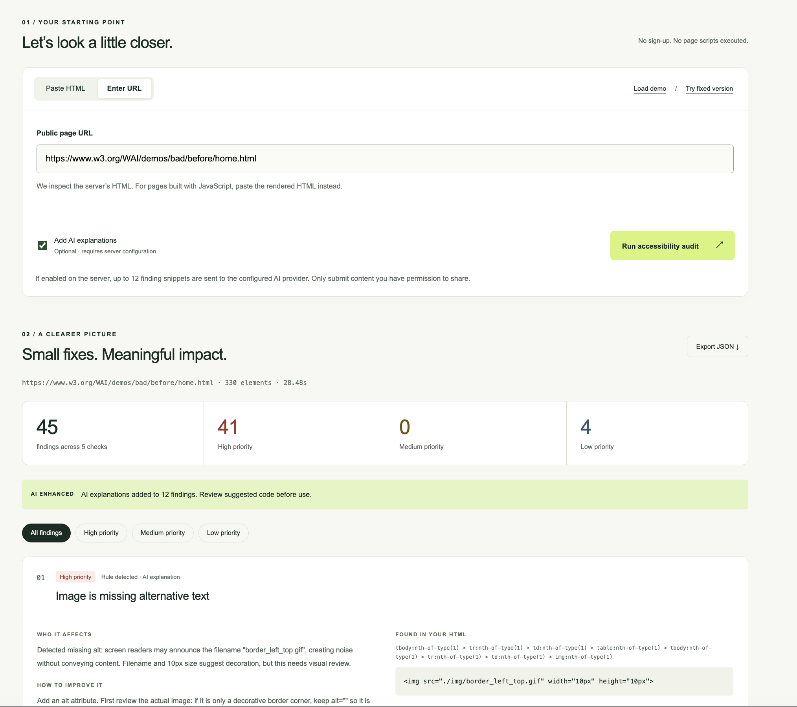

# AccessAudit

A small accessibility checker for HTML, with optional AI explanations.

Paste a page's HTML or enter a public URL. AccessAudit checks five common problems, shows the relevant markup, and suggests what to change. The checks run without an API key. When AI is enabled, Muse Spark or GPT-6 Luna adds explanations to the findings.



## Demo

### Part 1
https://github.com/user-attachments/assets/6d53d0b7-9bd5-4413-8d80-5e6ed8bf24c2

### Part 2
https://github.com/user-attachments/assets/694e6af6-8b87-4ae3-aa6a-b82681ccf610

### Part 3
https://github.com/user-attachments/assets/7a156ed3-12a3-4c7e-a4d7-d2068dd7644f

Example reports from the W3C before-and-after demo:

- [Before: 45 findings, including 12 AI explanations](docs/before.json)
- [After: no findings in the five implemented checks](docs/after.json)

## Run it

Use Node.js 24, or at least 22.19.

```sh
npm ci
npm run dev
```

Open http://127.0.0.1:3000. If that port is busy, run `npm run dev -- --port 3100`.

For a production build:

```sh
npm run build
npm start
```

If the development server hits a file-watcher limit on your machine, the production build is also a useful way to run the demo locally.

## Add AI explanations

Copy `.env.example` to `.env.local`. For Muse Spark:

```env
ENABLE_AI=true
AI_PROVIDER=auto
MODEL_API_KEY=your-meta-model-api-key
MUSE_MODEL=muse-spark-1.3
```

Use a key from the [Meta Model API dashboard](https://dev.meta.ai/). Muse uses Meta's Chat Completions endpoint with a JSON schema. To use GPT-6 Luna instead, set `AI_PROVIDER=openai` and configure `OPENAI_API_KEY` and `OPENAI_MODEL=gpt-6-luna`.

`AI_PROVIDER=auto` prefers Muse when `MODEL_API_KEY` is set and otherwise uses OpenAI. You can pin `AI_PROVIDER=muse` or `AI_PROVIDER=openai`. A failed request is never silently sent to the other provider. Existing Luna setups continue to work without new variables.

Restart the server, then check **Add AI explanations** before running an audit. Keep `.env.local` out of version control; it is already in `.gitignore`. The interface and demo steps are the same for either provider. Successful JSON exports include `aiProvider` and `aiModel` so you can check which configuration produced the explanations.

To check your configured provider with the five-finding demo:

```sh
npm run check:ai
```

This makes a real API request using your key. Success prints `aiStatus: "enabled"`, the provider/model, and `explained: 5`. It never prints your key. Missing configuration or provider failures return a nonzero exit status.

AI is optional. If the key is missing or the request fails, the report still includes the original findings and rule-based guidance. The model receives finding excerpts, not the whole page, and returns structured output. Each explanation is validated and matched to its finding ID before use. The model cannot change the findings or their priorities.

The rules scan the full submitted HTML. For AI explanations, the app takes up to 12 findings in priority order to keep response time, output length, and API cost manageable. This is an application setting, not a model limit. Findings outside that batch still include the rule-based impact, suggested fix, and example code.

Only submit markup you are comfortable sending to the configured provider. Reports are not stored in a database. OpenAI requests use `store: false`; provider retention and use policies still apply. See [OpenAI's data controls](https://developers.openai.com/api/docs/guides/your-data) and the policies applicable to your Meta Model API account.

## Checks

| Check                             | Priority   | Notes                                                                        |
| --------------------------------- | ---------- | ---------------------------------------------------------------------------- |
| Image without alternative text    | High       | An empty `alt` is allowed for decorative images.                             |
| Form control without a label      | High       | Checks labels and common ARIA naming patterns. A placeholder does not count. |
| Button without an accessible name | High       | Includes native input buttons and elements with `role="button"`.             |
| Skipped heading levels            | Medium     | A prompt to review the outline, not an automatic WCAG failure.               |
| Empty or vague link text          | High / Low | Empty names are High; generic phrases need context and are Low.              |

The priorities are a practical order for reviewing issues, not WCAG severity ratings. Each finding includes a CSS path, an HTML excerpt, its likely impact, an example fix, and a W3C reference. You can filter the results or download the report as JSON.

## Try the example

1. Click **Load demo** and run the audit. The example has five findings: three High, one Medium, and one Low.
2. Open a finding's example fix. With AI enabled, compare the explanation against the source.
3. Click **Try fixed version** and run it again. The five checks should return no findings.

The before and after pages are also in [`examples/`](examples/). A clean result only means these checks found nothing; keyboard, screen-reader, and contrast testing still matter.

## How it works

```text
HTML or public URL
  → input and URL validation
  → Cheerio parses static HTML
  → five rules produce findings
  → optional Muse Spark / GPT-6 Luna explanations
  → report and JSON export
```

The scanner owns detection so that a repeated audit of the same markup produces the same findings. AI handles the explanatory part, where context and plain language are more useful than another detection pass.

The main files are:

- [`lib/audit.ts`](lib/audit.ts): rules, accessible-name helpers, and report evidence.
- [`lib/safe-fetch.ts`](lib/safe-fetch.ts): URL restrictions, DNS checks, redirects, and bounded reads.
- [`lib/explain.ts`](lib/explain.ts): shared output validation and fallback.
- [`lib/ai-providers.ts`](lib/ai-providers.ts): provider selection and API request/response adapters.
- [`app/api/audit/route.ts`](app/api/audit/route.ts): request validation and orchestration.
- [`app/page.tsx`](app/page.tsx): input, results, filters, and export.

URL requests reject local/private addresses and nonstandard ports. DNS answers are checked before connecting, the selected IP is pinned to the connection, and redirect destinations are validated again. Requests have a shared 10-second timeout and a 500 KB response limit. Reports show at most 100 findings while retaining the total count. Submitted markup is displayed as text and is never executed.

## Tests

```sh
npm test
npm run build
npm run typecheck
```

Tests cover the five rules, common false positives, request validation, URL restrictions, and AI output matching/fallback. Provider responses are mocked in the test suite, so tests do not spend API credits. See the [verification notes](docs/VERIFICATION.md) for manual checks.

## Deploy

Import this repository into Vercel as a **Next.js** project with Node **24.x** and the default build settings. There is no database to configure.

For a public demo, leave `ENABLE_AI=false`. For a private AI demo, add the environment variables for your chosen provider and use deployment access protection. The current version does not have authentication, distributed rate limiting, or per-user quotas. Those controls are needed before exposing paid AI to unrestricted public traffic. A host with outbound-network controls is also preferable for a public URL-fetching service.

## Why accessibility

AccessAudit explores barriers in everyday web interfaces. AccessLens is the next project idea: applying that same interest to physical spaces with multimodal assistance. The scope here stays narrow so the behavior is easy to inspect and demonstrate.

## References

- W3C: [images](https://www.w3.org/WAI/tutorials/images/), [form labels](https://www.w3.org/WAI/tutorials/forms/labels/), [buttons](https://www.w3.org/WAI/ARIA/apg/patterns/button/), [headings](https://www.w3.org/WAI/tutorials/page-structure/headings/), [link purpose](https://www.w3.org/WAI/WCAG22/Understanding/link-purpose-in-context.html)
- [Meta structured outputs](https://dev.meta.ai/docs/cookbook/structured-output)
- [OpenAI structured outputs](https://developers.openai.com/api/docs/guides/structured-outputs)
- [Cheerio](https://cheerio.js.org/docs/basics/loading/)
- [Next.js route handlers](https://nextjs.org/docs/app/getting-started/route-handlers)

[한국어 실행 안내](docs/QUICKSTART.ko.md) · [MIT license](LICENSE)
